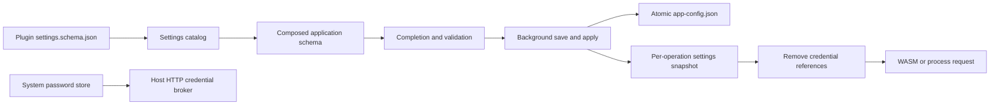

# Full configuration editor

Open **Settings → Advanced** to edit the complete JSON configuration, including
`extension_accounts` and `extension_settings`. Open an extension's
**Credentials** section to store its declared keys.
JSON is the application's persisted format. Windows paths need escaped backslashes,
for example `"Z:\\archive"`; forward slashes also work in Windows path values.

The editor provides automatic key/value suggestions and Ctrl+Space completion at
the current cursor. Enter or Tab accepts a suggestion; Escape closes the list.
Completions understand nested objects, arrays, plugin IDs containing dots, enums,
booleans, declared defaults and numeric bounds. They replace the current token
without duplicating an existing colon or value. Format JSON reformats valid input.

Validation reports JSON pointer paths for missing required properties, wrong
types, unknown fields and invalid enum/range values. Duplicate keys and documents
larger than 1 MiB are rejected. Additional application checks cover concurrency,
delay order, layout breakpoints and storage paths. Invalid documents cannot be saved.

**Save full configuration** validates again on a background worker, verifies the
selected database/folders, writes atomically and updates active settings, clipboard
monitoring, presets and library views. Saving waits for active operations to finish.
Changes to active settings or the saved file reject an outdated editor document.
**Reload saved settings** validates and applies the saved document; **Discard draft**
returns to the current active configuration. Reading schemas never executes plugins.

## Plugin declaration

Each new plugin package includes `settings.schema.json` next to `plugin.json`:

```json
{
  "$schema": "https://json-schema.org/draft/2020-12/schema",
  "type": "object",
  "x-archivesift-delivery": "state-v1",
  "additionalProperties": false,
  "properties": {
    "max_images": {
      "type": "integer",
      "minimum": 1,
      "maximum": 5000,
      "default": 5000,
      "description": "Maximum images collected from a content page."
    },
    "include_description": {"type": "boolean", "default": true}
  },
  "required": ["max_images", "include_description"]
}
```

These properties are composed under `extension_settings.<plugin ID>`. Installed
plugin IDs and account sections also participate in completion. Initial documents
include declared defaults. Explicitly removing a required field causes an error;
defaults are not silently substituted by the editor's save validation. Runtime
calls without an options section use defaults for backward compatibility.
Uninstalled plugin sections are retained, and become schema-validated when installed.

The bounded offline JSON Schema subset supports `type` (including nullable unions),
`properties`, `required`, `additionalProperties`, `items`, `enum`, `const`,
`minimum`, `maximum`, `minLength`, `maxLength`, `minItems`, `maxItems`, `uniqueItems`,
`default`, `title`, `description`, `examples`, `format` and `$schema`. Integer values
use JSON integer tokens. URI format checks absolute-URI syntax; secret-reference
format is described below. References, remote schema loading and unsupported keywords
are rejected rather than ignored. Schemas are limited to 64 KiB, 16 levels and
256 properties per object; validation returns at most 64 issues.

Legacy packages without a sidecar retain their old request protocol and have no
declared guest settings. Package changes require an application restart. Options
for already-loaded packages apply to subsequent operations without restarting.

## Credentials

Passwords and API keys never belong in the JSON document or guest DTOs. A plugin
can declare a host-only property with `"format": "secret-reference"`, a fixed
`const` target and an optional identical default:

```json
{
  "type": "string",
  "format": "secret-reference",
  "const": "ArchiveSift/example.parser/api",
  "default": "ArchiveSift/example.parser/api"
}
```

Targets must belong to `ArchiveSift/<own plugin ID>/`. The requirements panel lists
declared properties and provides masked credential entry for these targets. Store
credential writes to the system password store. Secret text is cleared from the
input, excluded from JSON and redacted in command diagnostics. Declaring a target
does not grant network permission: exact-origin/path credential bindings and account
profiles still determine where the host can send it. Account usernames and the
remember-password preference remain in `extension_accounts`; form sign-in is in
Settings → Form → Accounts. A valid reference does not assert that its secret or
session is present/valid; authentication checks remain part of account/HTTP handling.

## Runtime delivery



The WIT 1.0 contract is unchanged. Opt-in packages receive an envelope in the
existing opaque request state on every step:

```json
{"$archivesift":1,"settings":{"max_images":2},"state":"opaque guest continuation"}
```

The guest unwraps settings and its original continuation before processing. Fetch
results carry ordinary guest state; the host wraps it again for the next call.
The SDK exposes `settings_state` and `unpack_settings` helpers. Per-operation values
are immutable snapshots, so concurrent operations can use different options.
The complete configured continuation is still bounded by the 64 KiB transport limit.
Credential references are removed before delivery. Runtime permissions and limits
remain controlled by the package manifest and host.

Each plugin's effective option values are limited to 16 KiB before runtime delivery.

## Tests

`cargo test --locked --test configuration` covers schemas, validation, completion,
atomic saves, conflicts and credential isolation. Headless editor and orchestration
tests run with the library suite. The installed production demo WASM and native
process acceptance tests verify options change parsed metadata and downloaded files.
All fixtures use synthetic local data; no private site names or credentials are needed.
