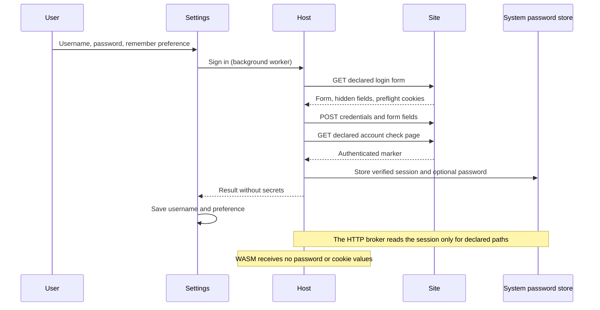

# Extension accounts

The host provides **Settings → Accounts** for installed extensions that ship an
optional `account.json`. Site-specific URLs, selectors and field names belong to
the extension package. The public application contains no supported-site list.
The sidecar is additive: the WASM API and WIT remain at version 1.0.

## Flow



## Declarative profile

```json
{
  "schema": 1,
  "login_url": "https://example.test/login",
  "check_url": "https://example.test/account",
  "form_selector": "form#login",
  "username_field": "username",
  "password_field": "password",
  "session_cookie": "session",
  "session_paths": ["/content", "/download"],
  "success_selector": "a#logout"
}
```

An optional `extra_fields` object contains static form defaults. It cannot
override the username or password fields. Hidden and submit inputs are obtained
from the selected real form. The response charset (or form `accept-charset`)
controls form encoding, including legacy charsets. Unrepresentable input fails
without substituting characters in the password.

The login/check endpoints must share a permitted HTTPS origin. The actual form
must use POST and resolve to the exact declared login URL. Redirects cannot cross
an origin boundary. Explicit HTTP permission is accepted only for literal
loopback IPs used by fixture servers. Response size, redirects and execution time
are bounded. CAPTCHA requires user interaction in a browser; the host does not
attempt to solve it.

Only a verified authenticated page and a nonempty named session cookie can
replace the stored session. Failed logins preserve the previous secrets. A failed
vault update attempts to restore the previous session and password. The broker
injects the session at the exact declared paths; query parameters do not widen
that scope. Cookies are not sent to image CDNs.

## Storage and UI

- Configuration contains an extension-ID map of `username` and
  `remember_password`. Passwords and session values are not serialized.
- Windows uses Credential Manager. Linux uses the desktop Secret Service through
  `secret-tool`; the desktop keyring must be available and unlocked. There is no
  plaintext fallback. Other operating systems currently report an unavailable
  store.
- Password targets are `ArchiveSift/<extension-id>/password`; sessions retain the
  existing `ArchiveSift/<extension-id>/session` target for cookie-helper compatibility.
- Secret buffers use zeroization and redact their debug representation. Password
  inputs are masked and moved out of the editor when a request starts. Errors and
  activity messages contain no request bodies, cookies or passwords.
- A blank password reuses a saved password for the saved username. **Check
  session** performs a fresh verification. **Forget account** deletes the local
  username, saved password and session. It does not remotely sign out other
  browsers.
- Sessions are reused after restart. If a session expires, **Sign in** can use the
  saved password. Automatic retries of rejected credentials are not performed.

The package producer must include `account.json` in its release checksum record.
It must never put real usernames, passwords or sessions in the profile, fixtures
or packages. Loopback integration tests cover form/CSRF handling, cookies,
redirects, legacy encoding, invalid credentials, challenges and vault failures.
Headless UI tests cover masking, request submission, saved-password reuse and
configuration persistence.
