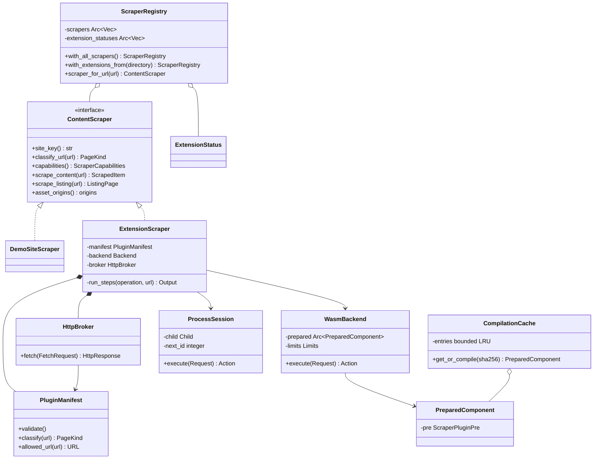
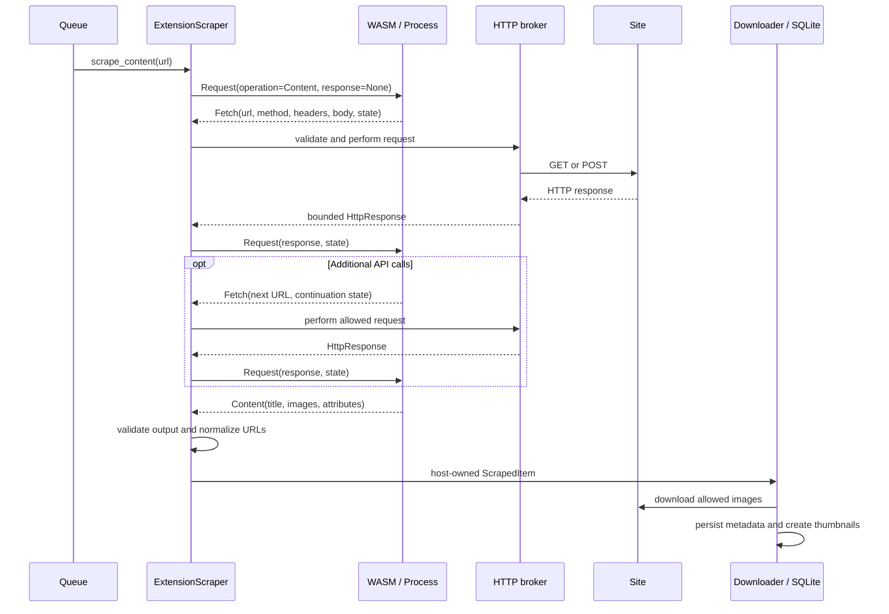

# ArchiveSift extension architecture

Status: implemented API 1.0. This document describes the public extension host,
the typed WASM interface, the process protocol, and their test coverage.

## Goals and runtime selection

ArchiveSift loads separately distributed parser packages without rebuilding the
desktop executable. Private adapters and their domain names belong exclusively
in separately distributed packages. The public application contains the runtime,
SDK, and a public example. No public catalogue of private adapters is needed.

| Runtime | Intended use | Execution boundary |
| --- | --- | --- |
| Built-in Rust | Demo and application modules | Application process |
| WASM Component Model | HTML parsing, JSON APIs, pagination and enrichment | Wasmtime Store with no WASI imports |
| Native process | Browser automation, JavaScript, Playwright, interactive authentication, native dependencies | Separate trusted executable, JSON-RPC over stdin/stdout |

The process backend is a usable transport for a browser adapter. This repository
does not bundle Chromium, Playwright, or a site-specific authentication flow.
An adapter packages those dependencies and owns its browser lifecycle. The
example process demonstrates the complete protocol using local HTML/API data.

## Package and class UML



`crates/scraper-api` contains serializable data and the native stdio helper. It
does not depend on the UI, SQLite, the downloader, or an HTTP library.
`crates/scraper-api/wit/scraper.wit` is the authoritative binary interface for
WASM: `archivesift:scraper@1.0.0`, world `scraper-plugin`.

Both transports expose `execute(Request) -> Result<Action, String>`. The WIT
boundary uses records, variants, lists and options, not an untyped JSON string.
Generated Rust WIT types are converted directly to the SDK types using moving
`From` implementations shared by host and guest through `impl_wit_conversions!`.
There is no JSON serialization in this bridge. Native JSON-RPC serializes the same
SDK types. Contract tests compare the representations, including optional fields,
metadata and continuation state, without changing API 1.0.

## Startup and registration

```mermaid
sequenceDiagram
    participant App
    participant Registry
    participant Loader
    participant Package
    App->>Registry: with_all_scrapers()
    Registry->>Loader: discover(default_plugin_directory)
    loop Sorted package directories
        Loader->>Package: read plugin.json (max 64 KiB)
        Loader->>Loader: validate schema, API, version, routes, limits
        alt Disabled or invalid
            Loader-->>Registry: ExtensionStatus
        else Enabled
            Loader->>Package: resolve entry and verify SHA-256
            Loader->>Loader: reuse SHA-256 cache or compile/type-check WASM; check process trust
            Loader-->>Registry: register ExtensionScraper + status
        end
    end
    Registry-->>App: clone of shared startup snapshot
```

The default directory is selected in this order:

1. `ARCHIVESIFT_PLUGIN_DIR`, when set.
2. `%APPDATA%/ArchiveSift/plugins` on Windows.
3. `$XDG_DATA_HOME/ArchiveSift/plugins` on Unix.
4. `$HOME/.local/share/ArchiveSift/plugins` on Unix.
5. `plugins-local` if no profile directory is available.

Every child directory with a `plugin.json` is a package. Packages are visited
in path order. A bad package produces a visible status and does not stop other
packages from loading. Duplicate enabled IDs, source keys and conflicting routes
are rejected. External routes take precedence over broad built-in demo routes.
URL matching checks exact hosts and path boundaries without invoking a guest.

`with_all_scrapers()` initializes one `OnceLock` snapshot. Both parser and status
vectors are shared through `Arc`, so cloning a registry is constant time. Registering
a parser on a clone uses copy-on-write and leaves existing snapshots unchanged.
UI filters, URL queue, clipboard handling and the downloader use this snapshot.
Modules are not compiled every frame. Changing packages or their local
enable/trust flags requires an application restart. There is no hot unload in
API 1.0. Tests can create independent snapshots from explicit directories.

The Extensions tab shows loaded, disabled and rejected packages with the reason.
It also shows the installation directory. Installation and enablement in this
version are file-based; the UI does not download or silently trust native code.

## Parsing and controlled HTTP



The listing operation returns discovered URLs with their operation kinds and an
optional next listing URL. The demo extension also expands a chain of JSON lazy
payloads. The guest returns explicit continuation state; it must not rely on
WASM global variables surviving a call. Each WASM call gets a fresh Store. A
native process stays alive for all steps of one scrape operation.

The host owns the source key, page URL, sort order, and local paths. A guest
cannot set a download path or choose a different persistence identity. For content
operations, the first fetched response is retained as diagnostic source HTML.
Listing operations do not retain this unused copy. Images and metadata are
converted to existing application models; SQLite and directory layout are shared
with the built-in pipeline.

## Process protocol

The host executes the package entry directly without a shell or manifest command
arguments. The working directory is the package directory. Windows processes use
`CREATE_NO_WINDOW`. The child environment is cleared, with only SystemRoot,
WINDIR, TEMP and TMP preserved when present. Package any required browser runtime
or interpreter with the executable; inherited PATH or account environment secrets
are not part of the protocol.

Each UTF-8 line is one JSON-RPC 2.0 message:

```json
{"jsonrpc":"2.0","id":1,"method":"execute","params":{"api_version":1,"operation":"Content","url":"https://example.test/galleries/one/","response":null,"state":null}}
```

```json
{"jsonrpc":"2.0","id":1,"result":{"Fetch":{"url":"https://example.test/galleries/one/","method":"Get","headers":[],"body":null,"state":null}}}
```

The response must contain the matching ID and exactly one of `result` or `error`.
Errors use `{ "code": -32000, "message": "..." }`. Stdout is reserved for the
protocol; arbitrary output is rejected. Child stderr is discarded in this
version. The SDK provides `serve_stdio` for the normal request/response loop.
Timeout, cancellation or completion drops and terminates the direct child.
The adapter must arrange cleanup for any browser subprocesses that it starts.

## Package example

```text
plugins/
  example.parser/
    plugin.json
    adapter.wasm
```

```json
{
  "schema": 1,
  "id": "example.parser",
  "version": "1.0.0",
  "api": "1.0",
  "display_name": "Example parser",
  "source_key": "example-source",
  "runtime": "wasm",
  "entry": "adapter.wasm",
  "sha256": "REPLACE_WITH_64_HEXADECIMAL_DIGITS",
  "enabled": true,
  "trusted": false,
  "routes": [
    { "host": "example.test", "path_prefix": "/galleries/", "kind": "content" },
    { "host": "example.test", "path_prefix": "/channels/", "kind": "listing" }
  ],
  "network_origins": ["https://example.test", "https://cdn.example.test"],
  "allow_http": false,
  "limits": {
    "timeout_ms": 30000,
    "memory_mb": 128,
    "fuel": 50000000,
    "max_steps": 16,
    "max_response_bytes": 2097152,
    "max_output_bytes": 4194304
  }
}
```

Use `runtime: "process"`, the native executable filename and `trusted: true` for
an approved native package. Packages generated by the helper are disabled and
untrusted. Review the manifest locally, set the flags and restart to install.

`id` identifies the package. `source_key` identifies archive records and source
filters and must stay stable across adapter updates. `version` is SemVer for the
adapter. `api` is the exact supported host contract version. Schema/API major
changes require explicit host support; incompatible packages fail at load time.

## Execution limits and trust boundaries

| Boundary | Implemented behavior |
| --- | --- |
| WASM imports | No WASI, filesystem, networking, environment or process imports linked |
| WASM memory | One linear memory, default 128 MiB, plus bounded instances/tables |
| WASM CPU | Fuel per call and 10 ms epoch timer, plus overall job timeout |
| Host network | Exact origin allowlist, HTTPS by default, optional explicit HTTP for local fixtures |
| Redirects | Broker checks every hop and rejects cross-origin redirects; image downloader checks every redirected origin |
| Response bodies | Default 2 MiB each, 8 MiB total per job, including streamed bodies |
| Plugin output | Default 4 MiB per action, maximum 5,000 images/links and 1,000 attributes |
| Continuations | Default 16 steps, maximum 64 KiB state |
| Package integrity | Entry stays within the package, maximum 32 MiB module, SHA-256 required |
| Process | Explicit local trust, protocol limits and timeout; native OS permissions remain those of the account |

WASM memory limits constrain guest linear memory, not the entire application RSS
or JIT compilation memory. Output limits are checked after canonical ABI lifting;
they are not a hard cap on temporary host allocations while decoding nested WIT
values. A trusted native executable can access files and the
network directly; process separation is crash isolation, not an OS sandbox. Native
memory/fuel limits in the manifest do not sandbox that executable. The HTTP broker
enforces permissions for host-mediated requests, not for a native browser's own
traffic. Future OS sandboxing must be implemented separately per platform.

Origins identify network destinations, not guaranteed public IP addresses: DNS
resolution follows the machine's resolver. Granting an origin also authorizes
the addresses it resolves to. Local fixtures explicitly opt into loopback HTTP.

Credentials are not embedded in the SDK or manifests generated by this repository.
There is no generic credential injection or browser login UI in API 1.0. Trusted
browser adapters can manage their own dedicated session. A future host credential
provider can attach secrets to an approved origin without returning them to WASM.

SHA-256 checks integrity against the locally installed manifest. It does not
authenticate a publisher who controls both files. This version has no automatic
update service, remote package discovery, or signature trust store. Replace an
approved package atomically and restart; native entry hashes are checked again
before each launch. Native verification streams 64 KiB chunks, and launch-time
verification runs on a blocking worker rather than an async executor thread.
WASM compilation uses immutable bytes paired with the digest computed during
integrity verification.

Distribution privacy is separate from code execution isolation. Domain names and
selectors remain in the locally installed manifest/WASM/native artifact and can
be inspected by its owner. Keeping them confidential from that owner requires a
server-side adapter. Nothing in the public loader lists private sites.

## Build, packaging and local installation

```powershell
rustup target add wasm32-unknown-unknown
cargo build --locked -p archive-sift-demo-plugin --lib --target wasm32-unknown-unknown --release
cargo run --locked -p archive-sift-plugin-packager -- wasm target/wasm32-unknown-unknown/release/archive_sift_demo_plugin.wasm plugins-local/demo-wasm https://javaquasar.github.io

cargo build --locked -p archive-sift-demo-plugin --bin archive-sift-demo-process --release
cargo run --locked -p archive-sift-plugin-packager -- process target/release/archive-sift-demo-process.exe plugins-local/demo-process https://javaquasar.github.io
```

The packager wraps the core guest module as a validated Component Model binary,
calculates SHA-256 and writes the disabled package. For the hosted demo, adjust
route prefixes to `/ArchiveSift/galleries/`, `/ArchiveSift/channels/`, and
`/ArchiveSift/models/`. Install only one example for the same routes at a time.

To use a local package directory:

```powershell
$env:ARCHIVESIFT_PLUGIN_DIR = (Resolve-Path plugins-local).Path
cargo run --locked
```

Inspect the Extensions tab. Enabled packages are available through the URL
field, clipboard queue, source filter and existing download flow. Changing
`ARCHIVESIFT_PLUGIN_DIR` or package files takes effect after restart.

## Test matrix and CI

```powershell
rustup target add wasm32-unknown-unknown
python scripts/test_extensions.py
```

The script builds real WASM and process fixtures with `test-fixtures`, packages
them under ignored `target/test-plugins`, and separately packages the production
demo WASM component without that feature under `target/test-plugins/demo-wasm`.
It then runs workspace tests. The test
feature deliberately exposes looping, trapping and malformed-result behaviors;
do not enable it in production packages. Use `--prepare-only` followed by
`cargo test --locked --workspace` to run tests directly. Missing binary fixtures
fail with a preparation instruction; integration tests are never silently skipped.

Run only the installed production demo WASM acceptance checks with:

```powershell
python scripts/test_extensions.py --wasm-demo-only
```

`tests/wasm_demo_site.rs` copies the actual packager output into a temporary
installation directory, verifies its Component Model header, hash and manifest,
and connects it through `ScraperRegistry::with_extensions_from`. The built-in
parser remains registered, so assertions on `demo-wasm` detect accidental fallback.
A local server serves the real `demo-site` HTML/JSON/PNG files under both
`/demo-site` and the GitHub Pages-style `/ArchiveSift` prefix. There are no live
site dependencies. Legacy full-image placeholder URLs are parsed with explicit
permission and are not fetched; the random showcase verifies real file downloads.

| Layer | Coverage |
| --- | --- |
| SDK | JSON roundtrip, exact byte budgets with Unicode/escaping, early rejection of oversized output |
| WIT bridge | All request/action variants, optional fields, metadata, wire compatibility and moved response-buffer identity |
| Manifest/registry | Schema/API versions, IDs, paths, streamed hashes, size bounds, disabled/untrusted packages, duplicates, routes, isolated failure and copy-on-write snapshots |
| Component loader | Rejects core modules and incompatible Component Model contracts |
| Compilation cache | Concurrent reuse, compilation outside the map lock, LRU eviction, live references and cached ABI failures |
| Both real runtimes | HTML, listings, lazy API chain, POST with state, permission errors, result kind, explicit guest errors, output bounds |
| WASM execution | Fuel exhaustion, memory failure, trap isolation and successful reuse afterward |
| Native execution | Timeout, bounded framed RPC and direct-child lifecycle |
| Download integration | Six PNGs, metadata, source/tag query, SQLite, local files and thumbnails |
| Installed production WASM demo | Real package discovery, exact metadata, every demo gallery, real channel/model/lazy pages, distinct PNG content, installation failures and HTTP error recovery |
| HTTP | Forbidden origins/headers, redirect escape, bounded response bodies and image redirect permissions |

CI prepares the guest/tool fixtures and runs the full workspace test suite on
Windows, then builds the desktop release and uploads its executable. The public
demo site's Pages workflow remains independent.

## Performance analysis and implemented changes

The extension path previously copied request bodies before each call, converted
WIT records through JSON in both host and guest, and allocated serialized output
just to check its size. Explicit registry loads also repeated compilation and
link resolution for identical WASM bytes. These costs grow with response size or
the number of independently loaded snapshots.

The implementation now:

- Moves requests and WIT fields, preserving owned string buffers across the SDK
  bridge. The canonical ABI still copies values across the guest memory boundary.
- Checks each returned action's exact JSON size once through a bounded sink.
  Native RPC uses a bounded serializer because it needs the actual wire bytes.
  Serialized length is bounded; allocator capacity and ABI lifting allocations
  are not a hard process-memory limit.
- Shares prepared components in a process-wide cache keyed by the verified
  SHA-256 digest. The cache retains at most four entries in LRU order, including
  failed ABI checks. A per-entry `OnceLock` shares concurrent compilation while
  the entry is resident; compilation does not hold the cache map lock.
- Reuses only compiled code and resolved imports. Every execution creates a new
  Store with the current manifest's limits and cancellation state. Permissions,
  guest globals, responses and credentials are never cached. Active backends can
  keep prepared code alive after cache eviction. There is no serialized AOT cache.
- Shares registry vectors, streams native integrity checks, reuses valid UTF-8
  HTTP body buffers, and avoids diagnostic HTML copies for listing operations.

### Reproducible local measurement

```powershell
python scripts/test_extensions.py --prepare-only
cargo run --locked --offline --example extension_benchmark
```

The example loads the installed production demo WASM three times, clones a
registry 20,000 times and parses a local HTTP response with a 32 KiB description
12 times. It checks the parsed metadata and image count. These are measurements
from one before/after run on this development machine in the unoptimized `dev`
profile, not a release performance guarantee or an internet download benchmark.

| Measurement | Before | After |
| --- | ---: | ---: |
| Repeated load of identical WASM, mean of second/third loads | 17,022 ms | 63.2 ms |
| 20,000 registry clones | 15.34 ms | 0.58 ms |
| Mean local parse, 12 calls | 10.43 ms | 9.68 ms |
| Production demo component size | 1,090,569 bytes | 1,021,780 bytes |

Cold compilation still took about 15 seconds in the dev run. The load improvement
applies when the same component is already cached in this process; the normal UI
already shares a single startup snapshot. The parse difference is small and needs
more samples before claiming a meaningful runtime improvement. The direct bridge
does remove the intermediate JSON allocations regardless of timing noise.

## References

- [Wasmtime security](https://docs.wasmtime.dev/security.html)
- [Wasmtime Component Model binding generator](https://docs.wasmtime.dev/api/wasmtime/component/macro.bindgen.html)
- [WIT specification](https://github.com/WebAssembly/component-model/blob/main/design/mvp/WIT.md)
- [JSON-RPC 2.0 specification](https://www.jsonrpc.org/specification)
