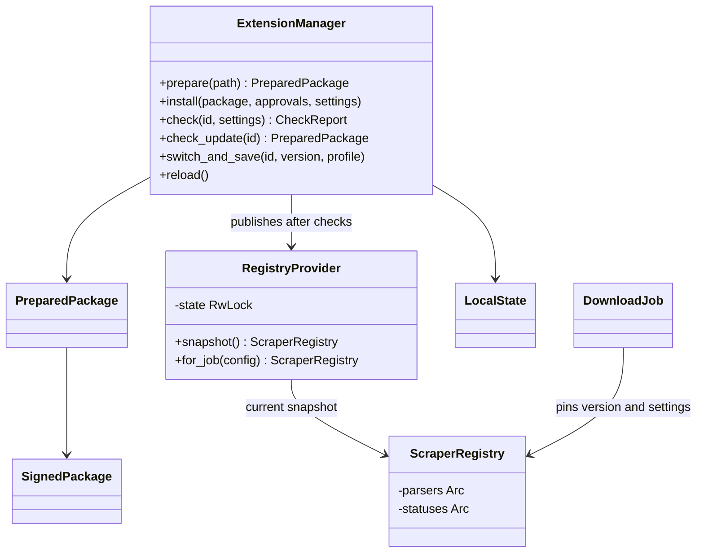
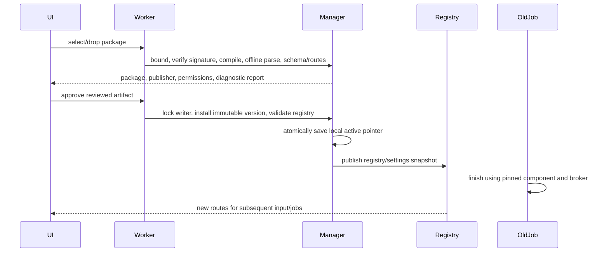

# Extension manager

The Extensions tab installs `.asift-plugin` files (ZIP containers), imports legacy
packages, enables/disables parsers, checks them, and selects installed versions.
Drop a package onto this tab or use **Install extension**. Compilation and parsing
checks run in a worker; the desktop remains responsive.

Before activation, review the exact artifact hash, Ed25519 publisher key, scraper
API, native/WASM runtime, settings schema and network origins. Newly requested
origins and publisher changes are highlighted. A native process needs a separate
approval because it runs with the user's account permissions. Unsigned packages
can be explicitly approved for local development or legacy import; an update
source never accepts them. No origin or native execution grant is inferred from
the publisher's `enabled` or `trusted` fields.

## Versions, settings and jobs

Publisher bytes remain unchanged:

```text
plugins/
  extensions-state.json
  .extension-manager.lock
  packages/
    example.parser/
      1.0.0--<artifact-hash-prefix>/
        plugin.json
        adapter.wasm
        settings.schema.json
        self-test.json
        package.asift-plugin
      2.0.0--<artifact-hash-prefix>/...
```

`extensions-state.json` contains active/previous version pointers, enabled state,
per-version origin grants, publisher public keys, native approvals, settings
snapshots and optional update sources. Actual plugin settings remain editable in
Settings → JSON. Snapshot values contain configuration and secret references;
passwords, session cookies and tokens remain in the system password store.
An installer does not modify the publisher manifest or replace older directories.
Publishing different bytes under the same semantic version is rejected.

**Use this version** or **Roll back** opens a confirmation. The switch restores
that version's schema-compatible settings, preserving the rest of the profile.
An OS file lock serializes writers, including separate application instances. A
`switch-journal.json` records a settings/pointer transaction. At profile load an
interrupted transaction either finishes the committed switch or restores the
previous configuration. Unexpected external configuration edits stop recovery
instead of being overwritten.

The registry provider publishes immutable snapshots through a short write lock.
Each download pins a registry and its settings before its first throttle delay.
Parsing, pagination, image requests and attachments use that same snapshot. Old
components and native executables remain available until all their jobs finish;
new manual input, clipboard events, listing results and MCP queue requests see
the current routes. Reloading does not require restarting or enabling agent access.

Legacy flat directories still work. **Import legacy package** creates a managed
copy after review. The old directory is retained for any existing jobs; managed
state takes precedence over its ID on subsequent discovery. Use the manager for
later changes, rather than rewriting an installed manifest.

## Diagnostics

**Check extension** reports disabled, missing settings, authorization required,
incompatible API/WIT, route conflict, parser failure, or ready. Checks include
hashes, complete payload integrity, schema validation and WASM import/export type
checks. Optional `self-test.json` contains an SDK `Request` with a supplied HTTP
response and an expected `Content` or `Listing` action. It runs with no broker,
network or credentials; a failed check prevents loading/activation. It is limited
to 1 MiB and at most 3 seconds of guest execution. The demo ships a real parsing
fixture. Missing fixture coverage is shown explicitly. Native diagnostics verify
metadata and executable hashes without launching native code.

Authorization diagnostics detect a missing stored session. An existing session
may have expired; Settings → Accounts performs the authenticated session check.
Offline diagnostics do not silently sign in or issue external test requests.

## Local and private release sources

Update sources are configured separately for each installed extension. They are
local user data, not part of a public catalog or a package-controlled URL:

```json
{"kind":"directory","path":"/absolute/path/to/packages"}
```

On Windows, enter an absolute native path with JSON escaping, for example
`"C:\\Packages"`. GitHub Releases use:

```json
{"kind":"github","repository":"owner/repository","asset_prefix":"example-parser-"}
```

Save the GitHub token using the password field in the source dialog. It is stored
under the source's OS credential target, never inside this JSON. Give it read
access to the selected repository's contents. Requests authenticate only to
`api.github.com`; download redirects are manually checked against an exact HTTPS
allowlist, and API credentials are never forwarded to asset CDNs.

**Check for updates** stages the highest newer semantic version signed by the
current version's publisher. It does not install or grant additional permissions.
The same review step confirms its full origins, schema and artifact. Another
publisher/key requires an explicit manual import. Directory lookup is bounded to
128 packages; GitHub lookup considers the first 50 non-draft stable release
records and up to eight matching assets. Prerelease packages can be installed
manually. A source with no trusted signed upgrade reports that clearly.

## Building and signing packages

The existing `wasm`/`process` packager commands still create disabled directories.
An optional `self-test.json` next to a template is copied into its output.

```text
cargo run -p archive-sift-plugin-packager -- keygen /private/publisher.pk8
cargo run -p archive-sift-plugin-packager -- bundle /path/to/package example.asift-plugin --signing-key /private/publisher.pk8
cargo run -p archive-sift-plugin-packager -- verify example.asift-plugin
```

The tool also accepts a PKCS#8 Ed25519 key encoded as hex in
`ARCHIVESIFT_SIGNING_KEY`, suitable for a protected CI secret. Key generation uses
exclusive creation and mode 0600 on Unix; restrict the private file's ACL to its
owner on Windows. Keep private keys outside source control. An unsigned bundle
omits the signing argument/environment variable.

The signature file is `package-signature.json`:

```text
{ index: { schema: 1, files: { filename: sha256, ... } }, public_key: hex, signature: hex }
```

Sign `ArchiveSift package v1\n` followed by compact UTF-8 JSON of the index, with
fields `schema`, then `files`, and file names sorted lexicographically. Every
payload file, including the manifest, settings, account/reference declarations,
release record and test fixture, is covered. The signature file itself is
excluded. A verified signature proves possession of that key; the user still
decides whether to trust its publisher.

ZIPs are bounded to 40 MiB compressed/expanded, 24 regular entries and a 32 MiB
module. Metadata is limited to 64 KiB per file. Duplicate/case-colliding names,
unexpected payloads, traversal, absolute paths, symlinks and managed directory
reparse points are rejected. Packages cannot supply compiled native WASM cache
artifacts. WIT `archivesift:scraper@1.0.0` remains unchanged.

## Persistent compilation cache

The four-entry memory cache is backed by an optional host-owned disk cache in
`%LOCALAPPDATA%\ArchiveSift\wasm-cache` or
`$XDG_CACHE_HOME/ArchiveSift/wasm-cache` (`~/.cache` fallback). Its identity binds
module SHA-256, application version and Wasmtime's engine compatibility hash
(runtime/compiler, target, CPU features and engine flags).

Only serialized components produced by this host are authenticated with an
HMAC key kept in the OS password store. Authentication over exact owned bytes
and their cache identity happens before Wasmtime deserialization. A publisher
signature is never sufficient to admit native cache bytes. Corruption, an absent
keyring, a missing entry, incompatible engine metadata or a failed write falls
back to compilation. The cache retains at most eight artifacts and 256 MiB;
individual artifacts are bounded to 128 MiB.

Host keys use the reserved `ArchiveSift/@host/` namespace, which cannot belong to
a valid plugin ID. Neither a schema declaration nor an HTTP credential binding
can access it. Cache keys are stored as hex text for Linux `secret-tool` transport;
the HMAC uses the decoded random bytes.

## UML and verification





`tests/extension_manager.rs` exercises real production demo components, signed
installation and restart, route conflicts, incompatible WIT, modified payloads,
missing settings, offline failures, pinned in-flight image downloads, queue
updates, signed source selection and restoring incompatible settings schemas.
Unit tests cover archive/signature tampering, cache authentication and reuse
through fresh engines, corruption fallback, configuration journal recovery and
headless UI behavior. CI runs package/manager/cache checks on Windows and Linux.
