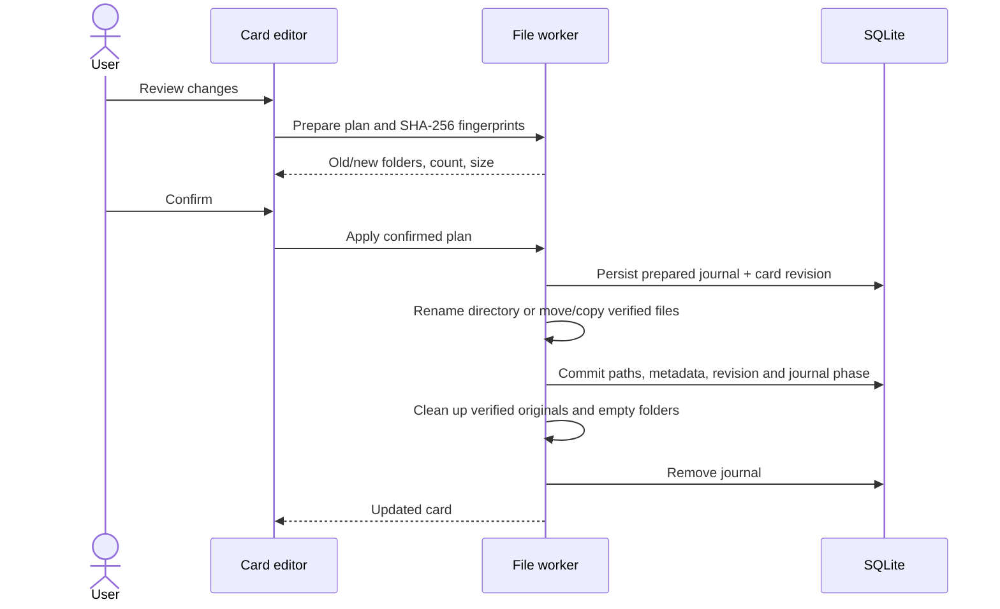

# Torrent cards and studio folders

Search has separate Images and Torrents modes. Torrent cards include attachment-only
pages, so a missing poster does not hide a release. The torrent list supports text,
source, studio, year, tag and category filters, with 40 cards per page.

New torrent pages use the following layout, relative to the configured effective
download folder (including its optional subfolder):

```text
torrents/<source>/<primary studio>/<content title> [topic ID-URL hash]/
    <attachment>.torrent
    <reference>.magnet.txt
    images/
```

There is no year directory. Dates and years remain searchable metadata. The URL
hash distinguishes topics with the same visible identifier; portable components
handle Unicode, forbidden characters, Windows device names and trailing dots.
All generated paths use the platform's native separators.

## Editing

Open Search → Torrents and select a card. Choose a primary studio, or add a new
studio and select it. Add/remove tags and categories using their editors; existing
values are suggested as you type. Tags and categories are independent, multiple
values per card, and do not affect the folder structure.

Review and save prepares a preview containing the source locations, destination,
file count and size. Nothing moves until Confirm and move. Cancel retains the
draft without writing it. Metadata-only confirmation keeps current file locations.

The complete parser-provided studio list is retained. A separate primary selection
defaults to the first studio emitted by the parser, with an unknown-studio fallback.
Manual additions and removal overrides survive subsequent scrapes. Newly discovered
parser tags can still appear; removing one existing tag does not freeze the entire
tag set. The selected primary studio is also visible in image search results.

## Existing libraries

Schema initialization discovers existing attachment and magnet pages without moving
their files. Their directory stays unset until the user changes the primary studio
or checks Organize existing files into a studio folder and confirms. Only files
belonging to that legacy card are gathered. Existing managed card directories include
their user-added sidecars when moved. Thumbnail caches stay in their configured
cache folder; page-image and attachment paths are updated transactionally.

## Transfer and recovery



Operations run in background workers and are serialized per source page, together
with that page's downloads. Downloads of unrelated pages can continue in parallel.
An operating-system file lease prevents a second application instance from recovering
an active move. The lease is released automatically if its process exits.
Revisions reject stale editor confirmations. Existing destinations and changed file
contents are rejected before transfer, and a failed metadata commit rolls files back.

Same-volume managed directories use rename; cross-volume transfers stream through
an exclusive temporary file, sync it, and verify SHA-256 before finalization. Copies
retain their originals until the database commit. A file referenced by another page
is copied and its original retained. The application never starts a torrent client.

The SQLite journal records prepared and committed phases. Startup, opening the torrent
list and subsequent downloads recover interrupted work: prepared moves roll back,
committed moves finish cleanup. Recovery is idempotent. Changed files or a different
storage root retain the journal and report an error instead of discarding data.
Path traversal and symbolic links outside the archive are rejected.

## Validation

`cargo test --locked --test torrent_library` covers layouts, legacy organization,
manual metadata, filters, stale plans, collisions, failed commits and shared files.
`cargo test --locked --lib torrent` includes interrupted renames/copies, cleanup,
concurrent confirmations, migrations and headless UI confirmation/cancellation tests.
Attachment integration tests also reparse a moved card and verify it reuses files.
CI runs these checks on Windows and Linux. Tests use synthetic local data only.
