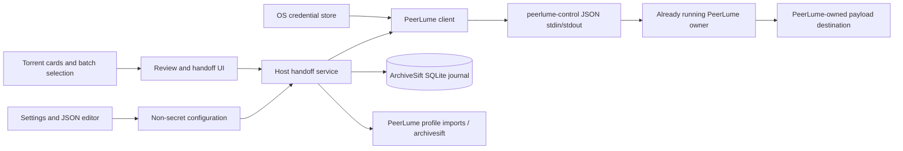
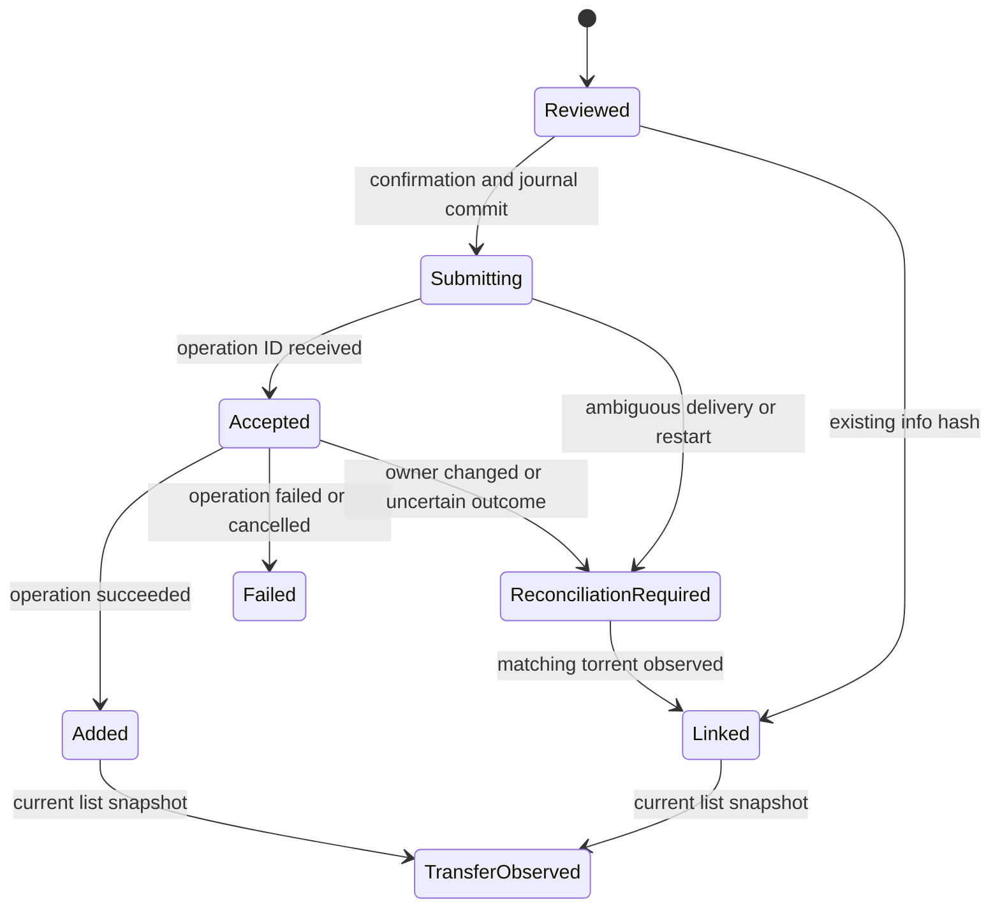

# PeerLume integration — first release

Status: first-release implementation, verified locally on Windows on 2026-11-05.
Publication and a tagged release are separate release steps.

## Purpose

ArchiveSift collects a release's metadata, artwork and original torrent file.
PeerLume owns the torrent engine, payload files and transfer lifecycle. The
integration lets a user review a collected torrent and hand it to an already
running PeerLume owner without locating the file manually or adding it twice.
It is implemented in the public application host, so every parser that produces
a local `.torrent` attachment can use it without a parser API change.

## Included in this release

- A PeerLume section in Settings, with an enable switch, absolute control-CLI
  path, absolute profile directory, existing relative payload destination and
  default start mode. The same non-secret settings are editable in the JSON
  editor, with completion and validation.
- A separate control token in the operating system credential store, scoped to
  the canonical profile and reserved for the host. Tokens are not configuration
  values and are never passed to parsers, command-line arguments or logs.
- A connection test that checks protocol 1, the running owner instance,
  capabilities and the `manage` grant needed for preview and add.
- A **Download in PeerLume** action on a torrent card and checkboxes for sending
  several cards. Every local `.torrent` attachment in the chosen cards is
  previewed; a magnet-only card produces a clear unsupported-source result.
- A review window showing the card title, file count, total size, private flag,
  info hashes, destination and **Start now / Add paused** choice. No add request
  is sent before confirmation. Each item can be excluded from a batch.
- A durable handoff journal in the ArchiveSift library database. Acceptance,
  confirmed add results and current transfer observations are different states.
  A handoff window can be reopened after restarting ArchiveSift.
- Duplicate protection by info hash and PeerLume profile, including torrents
  already present in PeerLume. A duplicate is linked to its existing task; the
  integration never silently creates a second copy in another destination.
- A confirmed failed operation can be retried only through a fresh review with
  **Retry confirmed failed handoffs with a new request** explicitly selected.
  Ambiguous delivery and torrents missing after an earlier successful add remain
  protected against resubmission.
- Background CLI calls with bounded input/output and a timeout. The desktop
  interface stays responsive while preparing, submitting or refreshing a batch.

## Setup and first download

1. Start PeerLume with the intended profile. Enable its restricted control API
   and create a dedicated client token with the `manage` grant. That existing
   grant is broader than add-only; ArchiveSift uses only discover, preview, add,
   operation, operations and list. It does not request export, removal or
   reporting grants. Access must be enabled again when the PeerLume owner
   restarts; closing a frontend alone may leave its owner running.
2. In ArchiveSift Settings, enable PeerLume, choose `peerlume-control` (or
   `peerlume-control.exe`) and the corresponding profile. Save the token using
   the masked token field, then test the connection.
3. Enter a relative destination that already exists inside the download root
   granted in PeerLume, for example `incoming`. PeerLume performs the final
   containment and permissions check. ArchiveSift cannot discover the absolute
   download root through this restricted API and does not create destinations.
4. Save the integration settings. Open Search, switch to torrent cards and click
   **Download in PeerLume**, or select cards and use the batch action.
5. Review the preview, choose the destination and start mode, exclude any items
   that should not be sent, and confirm. Inspect the durable handoff list for
   accepted operations and refresh it for transfer state and progress.

The token field is write-only. Changing a profile does not copy its token to the
new profile. Forgetting a stored token removes the local credential; revoke it in
PeerLume as well if the client should lose access. Enabling this integration does
not enable ArchiveSift's agent/MCP access or authorize agents to start transfers.

PeerLume's existing file-selection and verification defaults apply. This release
does not override them or provide a per-file selection editor.

## Configuration

```json
{
  "peerlume": {
    "enabled": false,
    "executable": "",
    "profile": "",
    "destination": "incoming",
    "start": false
  }
}
```

This is a section of the full application document, not a replacement document.
Old configurations remain compatible: an absent section uses these defaults.
Absolute local executable/profile paths are required when enabled. The
destination is a portable relative path with normal components only: no parent
traversal, drive prefixes, network roots, alternate streams or reserved names.
Use `/` between destination components on either OS; native executable/profile
paths are displayed and selected using the current platform's conventions.

## Architecture



The transport is behind a small request interface, allowing deterministic fake
clients in tests and a future direct IPC transport. The application never
imports PeerLume's engine crate, modifies its SQLite database, reads internal
full-trust authentication descriptors or starts its owner implicitly.

### Preparation and staging

The host loads current cards from its database and accepts attachments only
inside the configured archive root. It rejects symlinks/reparse points, path
escapes, non-files and metainfo above the existing 8 MiB attachment limit.
Metainfo is validated locally before calling PeerLume. A SHA-256 addressed copy
is staged under `PROFILE/imports/archivesift/`; existing staged content must have
exactly the same bytes. The original card attachment is retained.

The staged copy is persistent because PeerLume retains its source path. It is not
deleted after acceptance. Preview and confirmation use the same verified bytes
and info hashes. Stale previews or an owner/profile change require another
review. Card folder renames after a successful handoff do not move PeerLume's
payload and do not invalidate its source copy.

### Wire contract

The CLI is invoked directly, without a shell:

```text
peerlume-control request --profile ABSOLUTE_PROFILE
```

One JSON input document is written to stdin. The token is supplied only in that
child process's `PEERLUME_CONTROL_TOKEN` environment variable. Responses are
decoded as typed protocol-1 envelopes; raw stdout/stderr and tracker URLs are
never surfaced as errors. Input is limited to 64 KiB, stdout to the protocol's
256 KiB plus framing, stderr is drained with a bound, and child execution has a
timeout with termination/reaping. The owner instance returned by discover is
pinned for mutation and checked on responses.

### Durable delivery and reconciliation

Before sending add, ArchiveSift commits the exact source, destination, start
flag, owner instance, deadline and a random idempotency key to its own journal.
Reconciliation retains that original payload and never creates another add
request automatically. A response that merely accepts an operation is not a
successful download.

A retry of a confirmed failure is a separate, explicitly reviewed attempt with
a new key; its old journal record remains available. Duplicate reservations are
atomic across ArchiveSift processes sharing the same library database. A current
PeerLume snapshot also guards against torrents added through other clients.



Refresh is read-only. It polls operations and a revision-consistent paginated
torrent snapshot. Unacknowledged submissions are reconciled by their info hashes
and identifiable add operations where possible. An inconclusive result remains
**Reconciliation required**; it is not retried automatically. This conservative
rule prevents a crash or timeout from causing a second uncontrolled add. User
removal of a torrent in PeerLume is reported as missing, rather than silently
re-adding it. Changing profile never sends an old journal entry to the new owner.

Batches are deliberately not transactions across applications: some items may
succeed while another fails. Each item has its own durable record and result;
one failure does not erase successful items.

## Data ownership and privacy

- ArchiveSift owns descriptions, artwork, original attachments and its handoff
  journal. PeerLume owns payload bytes, file selection and transfer controls.
- The journal contains IDs, hashes, relative staging/destination paths and safe
  status codes. It contains no token, metainfo body, magnet URL, tracker passkey,
  parser implementation or supported-source catalogue.
- Staged torrent files can contain private tracker credentials. They remain
  local to the selected profile and are never committed, uploaded or exported by
  this integration. Profile and library directories are user-controlled local
  data; they must not be added to a public repository.
- The public test corpus uses synthetic metainfo and a fake owner. Private
  source names and real credentials are not required in public tests or docs.

## Validation and release gates

Automated coverage must exercise backward-compatible config/schema completion,
destination validation, token isolation, CLI framing and output limits, timeouts,
protocol/grant/instance errors, v1/v2 identities, bounded import staging, duplicate
and concurrent submissions, durable journal reload, operation transitions,
ambiguous delivery, revision-aware pagination and partial batch failures.
Headless UI tests cover the settings/review flow and confirmation boundary.
Existing unit/integration tests and the public privacy audit must pass.

Local verification includes 473 passing workspace tests, including 28 integration-specific
tests: 24 service/configuration/headless UI tests and four native subprocess
contract tests. The existing OS credential-store roundtrip test remains opt-in
because it needs an interactive desktop credential store. CI is configured to run
the new tests on both Windows and Linux. Linux execution is delegated to CI;
the local verification reported here was performed on Windows.

```text
cargo fmt --all -- --check
cargo test --locked --workspace --jobs 1
cargo test --locked --lib peerlume --test peerlume_control --jobs 1
cargo build --locked --release --bins --jobs 1
```

The repository publication audit also checks working-tree files and reachable Git
history for private source identifiers and credential-like values. It passes for
this implementation. The private parser package and WIT contract are unchanged.

A live smoke test is optional and requires a user-provided control token, enabled
PeerLume owner and a legal test torrent. It must be explicitly initiated by the
user; automated tests never use the real library or start P2P transfers.

## Deferred work

The restricted protocol currently has no magnet submission or destination-create
method. Magnet-only handoff, file-tree selection, coordinated payload moves,
automatic owner launch and persistent application pairing are outside this first
release. A later PeerLume change can add an explicit app-pairing flow with narrow
add-only grants and destination creation. Any agent-facing handoff must add a
separate explicit permission; existing scraping permissions are insufficient.
The existing transport boundary allows those changes without modifying parsers.
